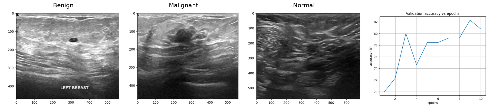

# Triple-Negative Breast Cancer: Diagnosis and Prognosis with Advanced Machine Learning

Detection and prognostic modelling for triple-negative breast cancer (TNBC). The work combines YOLO-based detection on breast cancer imaging with shrinkage operators, sequence networks, Kamada-Kawai graph layouts and elbow-method cluster analysis, plus a clinical-validation workflow that is currently demonstrated on a simulated patient dataset (see [Data](#data)).

This repository is part of a wider cancer imaging and medical imaging portfolio; see the [profile overview](https://github.com/datascintist-abusufian) for related work in dermoscopy, brain MRI and lung adenocarcinoma.

## At a glance

**Figure 1.** Example breast ultrasound images from the three classes, and validation accuracy of the YOLOv8 classifier over 10 training epochs. Output of `Yolov_model_demonstration_sufi.ipynb`.

| Model | Task | Train images | Validation images | Top-1 accuracy (validation) |
| :--- | :--- | :---: | :---: | :---: |
| YOLOv8n-cls (1.4 M parameters, 64 × 64 input) | Benign / malignant / normal | 1,448 | 130 | **82.3%** |

*Note:* the training and validation folders in this run also contain the segmentation-mask images (`*_mask.png`) alongside the ultrasound scans, so this figure may not reflect accuracy on scans alone.

## Contents

### Detection on imaging data

- `Yolov_model_demonstration_sufi.ipynb` — YOLO detection model demonstration.
- `Yolo_Model_Result_Visualisation_sufi.ipynb` — visualisation and inspection of detection outputs.

### Modelling and prognostic analysis

- `Breast cancer detection_python_demonstration_sufi.ipynb` — baseline detection workflow.
- `Breast__Cancer_Detection__by_advanced_machine_learning_sufi_13_12_2023_.ipynb` — advanced machine learning pipeline.
- `Breast_Cancer_updated_code_new (1).ipynb` — revised pipeline.
- `phase_analysis_26_02_2024.ipynb` — phase analysis.
- `Supplimentary_phase_26-02-2024.ipynb` — supplementary analyses.

### Clinical-validation workflow (simulated data)

- `Clinical_Hospital_Data_Xian_Jiaotong_University_.ipynb` — statistical workflow (chi-square, logistic regression, ANOVA, Kaplan-Meier) run on the simulated dataset below.
- `Clinical_Hospital_Data_Xian_Jiaotong_University_Validation_.ipynb` — validation stage of the same workflow, on the same simulated dataset.
- `Clinical_validation_discovery phase.Rmd` — discovery-phase analysis in R.
- `Hospital Trial_Data.csv` — simulated 200-patient dataset generated in the notebooks (`np.random.seed(0)`); not real patient data.
- `Dataset Documentation of Breast Cancer detection_13-12-2023_sufi.pdf` — dataset documentation.

## Method summary

Detection is handled by YOLO-family models applied to breast cancer imaging. Feature selection uses shrinkage operators; sequence networks provide representation learning over the selected features; Kamada-Kawai graph layouts are used to inspect structure in the feature space; and the elbow method selects the number of clusters for prognostic grouping. The clinical-validation notebooks set out a discovery-then-validation workflow; at present it runs on simulated data and is intended to be applied to a real hospital cohort.

## Running the notebooks

The notebooks run in Jupyter or Google Colab with a standard Python data-science stack (NumPy, pandas, scikit-learn, matplotlib) plus PyTorch and the Ultralytics YOLO package for the detection notebooks. The R Markdown file requires R with the packages loaded at the top of the document. Open a notebook and run cells in order; paths to `Hospital Trial_Data.csv` are relative to the repository root.

## Data

See the dataset documentation PDF in this repository for the description of variables. Imaging datasets used for detection are not redistributed here.

> **Simulated clinical data.** `Hospital Trial_Data.csv` is a simulated dataset of 200 patients (study ID, age, gender, residence, diagnostic method, time to diagnosis, diagnostic accuracy and satisfaction score). It is generated with a fixed random seed in the clinical notebooks to demonstrate the validation workflow. It does not contain real patient records, and results computed from it should not be read as clinical findings.

## Disclaimer

Research and educational use only. This is not a medical device and must not be used for clinical diagnosis or treatment decisions.

## Author

Md Abu Sufian — PhD researcher, University of East London. [GitHub](https://github.com/datascintist-abusufian) · [Google Scholar](https://scholar.google.com/citations?user=8ozStcUAAAAJ&hl=en)
